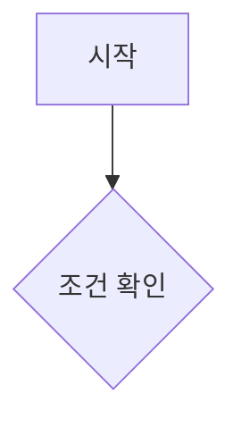
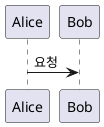

# revi-blog

Next.js 기반 개인 기술 블로그. 마크다운 콘텐츠 파이프라인, 다이어그램 렌더링, 검색, 방문자 통계 등을 자체 구현으로 갖추고 있습니다.

## 개요

- IT 기술의 동작 원리 등을 다루는 개인 기술 블로그
- 콘텐츠는 저장소 안의 마크다운 파일(`content/articles/`)로 관리하며, 별도의 CMS나 DB 없이 빌드 시점에 파싱합니다
- [spec-kit](https://github.com/github/spec-kit) 기반 Spec-Driven Development로 기능을 개발합니다 (`specs/`, `.specify/`)

## 주요 기능

- 커스텀 마크다운 렌더링 파이프라인 (콜아웃, 하이라이트, 수식, 위키링크, 지표 카드, 다이어그램)
- 자동 목차(TOC), 헤딩 퍼머링크, 이전/다음 글 탐색
- 코드 블록 언어 라벨 및 복사 버튼
- FlexSearch 기반 클라이언트 검색 (Cmd+K 커맨드 팔레트, `#태그명` 입력으로 다중 태그 AND 검색)
- Giscus 연동 댓글
- 이미지 라이트박스 (PhotoSwipe)
- 게시글 오디오 내레이션 재생
- 게시글 시리즈(연재) 그룹핑 및 탐색
- Upstash Redis 기반 방문자/조회수 통계
- 다크/라이트 테마 토글
- 북마크 페이지, RSS 피드, 사이트맵

## 기술 스택

- **프레임워크**: Next.js 16 (App Router), React 19, TypeScript
- **스타일**: Tailwind CSS 4
- **마크다운 파이프라인**: unified / remark / rehype, gray-matter, shiki, rehype-pretty-code, rehype-katex
- **검색**: FlexSearch, cmdk
- **다이어그램**: Mermaid, PlantUML(plantuml-encoder), Markmap
- **댓글**: Giscus
- **이미지**: PhotoSwipe, probe-image-size
- **데이터/통계**: Upstash Redis (`@upstash/redis`)
- **애니메이션**: Motion

## 프로젝트 구조

```
app/                Next.js App Router (페이지, API 라우트)
components/         UI 컴포넌트 (article, home, layout, search, stats, theme ...)
lib/                콘텐츠 파싱, 통계, 다이어그램, 훅 등 비 UI 로직
content/            블로그 원본 콘텐츠 (markdown, yaml)
core/               디자인 레퍼런스 정적 HTML 목업
public/             폰트, 이미지, 첨부파일
specs/              spec-kit 기능 명세 (spec.md / plan.md / tasks.md)
.specify/           spec-kit 워크플로우 및 프로젝트 헌법(constitution)
```

## 시작하기

### 사전 준비

- Node.js, npm
- (선택) 방문자 통계를 실제로 동작시켜 보려면 Docker Desktop

### 설치

```bash
npm install
```

### 환경 변수

`.env.example`을 참고해 `.env.local`을 작성합니다.

| 변수 | 설명 |
| --- | --- |
| `SITE_URL` | 배포된 사이트의 절대 URL (sitemap, RSS 등에 사용) |
| `KV_REST_API_URL` / `KV_REST_API_TOKEN` / `KV_REST_API_READ_ONLY_TOKEN` | Upstash Redis REST API 접속 정보 (Vercel Marketplace 연동 시 자동 생성) |
| `KV_URL` / `REDIS_URL` | Upstash Redis 연결 문자열 |
| `CRON_SECRET` | 방문자 통계 정리 Cron(`/api/cron/cleanup-stats`) 인증용 시크릿 |

로컬 `.env.local`에는 Upstash 값을 넣지 않는 것이 원칙입니다 — 넣으면 `next dev`가 프로덕션과 같은 Redis 인스턴스를 그대로 공유하게 됩니다. 값이 없으면 인메모리 mock으로 자동 폴백됩니다. 자세한 내용은 [방문자 통계용 로컬 Redis](#방문자-통계용-로컬-redis) 참고.

### 개발 서버 실행

```bash
npm run dev
```

기본적으로 `http://localhost:3999`에서 실행됩니다.

## 스크립트

| 명령 | 설명 |
| --- | --- |
| `npm run dev` | 개발 서버 실행 (인메모리 통계 mock 사용) |
| `npm run dev:docker` | 로컬 Docker Redis를 띄우고 개발 서버 실행 (통계 위젯 실제 동작 확인용) |
| `npm run build` | 프로덕션 빌드 |
| `npm run start` | 빌드된 앱 실행 |
| `npm run lint` | ESLint 검사 |
| `npm run redis:up` / `redis:down` | 로컬 Docker Redis 컨테이너 시작/종료 |

## 콘텐츠 작성

게시글은 `content/articles/` 아래에 카테고리별 디렉터리로 마크다운 파일을 추가해 작성합니다. 프론트매터로 다음 필드를 지원합니다.

```yaml
---
slug: my-custom-slug
title: 문서 제목
date: 2026-01-01
updated_at: 2026-01-02
tags: [tag1, tag2]
description: 목록/SEO에 노출될 요약
thumbnail: https://.../thumbnail.jpg
thumbnail_fit: cover
audio:
  - https://.../narration.mp3
reading_time_minutes: 5
show_on_homepage: true
---
```

| 필드 | 타입 | 필수 | 기본값 | 설명 |
|---|---|---|---|---|
| `slug` | `string` | 아니오 | 파일명(디렉터리 경로 제외) 기준 자동 생성 | 서로 다른 디렉터리의 두 파일이 같은 파일명을 쓰면 slug가 충돌해 빌드가 실패합니다 — 이때 충돌하는 파일 중 하나 이상에 직접 지정해 구분하세요. 파일명에 공백이 있어도 됩니다 — 자동 생성 시 공백은 하이픈으로 치환되어 URL에서 깨지지 않습니다. |
| `title` | `string` | **예** | - | 문서 제목 |
| `date` | `string` (날짜) | **예** | - | 발행일. 목록 정렬 기준 |
| `updated_at` | `string` (날짜) | 아니오 | 없음 | 최종 수정일. 상세 페이지에 노출 |
| `tags` | `string[]` | **예** | - | 태그 목록. QuickSearch·검색 필터링에 사용 |
| `description` | `string` | 아니오 | 없음 | 목록/SEO(메타 description)에 노출될 요약 |
| `thumbnail` | `string` (URL) | 아니오 | 없음 | 카드·공유 미리보기용 썸네일 이미지 URL |
| `thumbnail_fit` | `"cover"` \| `"contain"` | 아니오 | `cover` | 썸네일 크롭 방식. 로고처럼 크롭하면 안 되는 이미지만 `contain` |
| `audio` | `string` \| `string[]` | 아니오 | 없음 | 내레이션 오디오 URL. 없으면 재생 버튼 자체가 노출되지 않음. 배열로 주면 챕터별 선택 드롭다운이 뜸 |
| `reading_time_minutes` | `number` | 아니오 | 본문 기준 자동 계산 | 표시할 예상 읽는 시간(분)을 직접 지정하고 싶을 때만 사용 |
| `show_on_homepage` | `boolean` | 아니오 | `true` | `false`면 홈 카드 그리드/캐러셀, prev/next 네비게이션, `sitemap.xml`, `feed.xml`, 사이트 내 검색 인덱스에서 전부 제외되고 해당 페이지에 `robots: noindex, nofollow`가 붙어 검색엔진에 노출되지 않습니다. 단 URL 자체는 정적 빌드되어 직접 링크로는 계속 접근 가능합니다(내부 검증용 문서 등에 사용) |

> [!IMPORTANT]
> `content/articles/**`를 수정한 뒤에는 브라우저 새로고침만으로는 반영되지 않습니다. 콘텐츠는 모듈 최상단 `await`로 한 번만 로드되어 캐시되므로, 반드시 `next dev`를 재시작해야 변경 사항이 보입니다.

## QuickSearch 프리셋 관리

홈페이지 상단의 QuickSearch 버튼(예: "DataStructure", "Algorithm")을 추가·변경할 때는 `lib/data/quick-search-presets.ts` 한 곳만 수정합니다.

```ts
export const quickSearchPresets: QuickSearchPreset[] = [
  { id: "my-preset", label: "표시 이름", tags: ["tag1", "tag2"] },
]
```

- `tags`는 1~3개까지 지정할 수 있고, 글의 `tags`와 AND 매칭됩니다 (지정한 태그를 모두 가진 글만 필터링됩니다).
- 버튼 개수는 고정되어 있지 않습니다 — 배열에 항목을 추가·삭제하는 것만으로 늘리거나 줄일 수 있습니다.
- `label`은 버튼 표시 텍스트이자, 필터 활성화 시 "Entry Stream" 헤더 라벨에도 그대로 노출됩니다.
- 일반 TypeScript 모듈이라 `content/articles/**`와 달리 `next dev` 재시작 없이 즉시 반영됩니다.

## 시리즈(연재) 관리

게시글을 연재 시리즈로 묶을 때는 글 원문(frontmatter)을 건드리지 않고 `lib/data/series-presets.ts` 한 곳만 수정합니다 — 소속/순서의 단일 소스입니다.

```ts
export const seriesPresets: SeriesPreset[] = [
  { id: "my-series", label: "시리즈 이름", slugs: ["첫-번째-글-slug", "두-번째-글-slug"] },
]
```

- `slugs` 배열의 순서가 곧 시리즈 내 편 순서입니다 — 재배열도 이 배열만 고치면 됩니다.
- 한 글이 여러 시리즈에 동시에 속할 수 있습니다 (같은 slug를 여러 시리즈의 `slugs`에 등록).
- 존재하지 않는 slug를 참조하거나 같은 시리즈 안에서 slug가 중복되면 빌드가 실패합니다 (오탈자 방지).
- 상세 페이지의 태그 영역 아래에 시리즈마다 카드가 하나씩 노출되며 기본적으로 접힌 상태입니다. 펼치면 전체 목록이 10편 단위로 페이지네이션되어 나타나고, 새로고침하면 항상 접힌 상태로 돌아갑니다.
- 일반 TypeScript 모듈이라 `content/articles/**`와 달리 `next dev` 재시작 없이 즉시 반영됩니다.

## 지원하는 마크다운 확장 문법

### 콜아웃 (기본 / 커스텀)

Obsidian 스타일 콜아웃 문법을 지원합니다. `[#TYPE]`은 기본(GitHub Alert류) 스타일, `[!TYPE]`은 사이트 전용 커스텀 스타일로 렌더링됩니다.

```markdown
> [#NOTE]
> 기본(GitHub Alert류) 스타일 콜아웃

> [!NOTE]
> 사이트 전용 커스텀 스타일 콜아웃

> [!WARNING]- 접힌 상태로 시작하는 콜아웃
> `-`를 붙이면 collapsed, `+`를 붙이면 expanded 상태로 시작합니다.
```

지원 타입: `note`, `tip`, `warning`, `danger`, `info`, `success`, `question`, `bug`, `example`, `quote`, `important`, `abstract`, `todo`, `failure`, `collapse` 및 `caution`/`hint`/`check` 등 다수의 별칭.

### 하이라이트

`==텍스트==`는 `<mark>`로 렌더링됩니다.

```markdown
이 부분이 ==강조 표시== 됩니다.
```

### 수식 (KaTeX)

`remark-math` + `rehype-katex`로 인라인(`$...$`)/블록(`$$...$$`) 수식을 렌더링합니다.

### 위키링크 (Obsidian 스타일)

Obsidian vault를 그대로 옮겨온 콘텐츠와 호환되도록, 파일명/경로 기준으로 다른 글을 참조하는 wikilink와 이미지 embed 문법을 지원합니다. frontmatter의 `title`/`slug`가 아니라 **실제 파일 경로**만 링크 타겟으로 인식합니다.

```markdown
[[Tree]]                  <!-- 파일명 기준 — vault 전체에서 파일명이 유일할 때 -->
[[Tree.md]]                <!-- .md 확장자를 붙여도 동일하게 동작 -->
[[datastructure/Tree]]      <!-- 경로 포함 — 같은 파일명이 여러 디렉터리에 있을 때 구분용 -->
[[Tree|표시할 텍스트]]         <!-- 별칭 -->
![[image.png]]              <!-- 이미지 embed → /attachments/image.png로 resolve -->
```

- 파일명이 vault 전체에서 유일하지 않으면(같은 이름의 파일이 다른 디렉터리에도 있으면) 파일명만으로는 어느 문서인지 모호하므로, 그 경우엔 경로를 포함해서 써야 링크가 걸립니다.
- 대상 문서를 찾지 못하면 링크 대신 평문으로 표시됩니다.
- 이미지가 아닌 embed(PDF·오디오·비디오·다른 노트 embed 등)는 표시 UI가 없어 평문으로 남습니다.

> [!NOTE]
> 아래는 현재 미지원입니다 (`TODO.md` 참고, 필요성이 확인되면 착수 예정):
> - `[[Note#Heading]]`, `[[#Heading]]` 같은 헤딩 앵커 wikilink
> - `aliases:` frontmatter를 통한 별칭 매칭

### 지표 카드 (metrics)

`label: value` 형식의 줄을 나열하면 카드 UI로 렌더링됩니다.

````markdown
```metrics
Time Complexity: O(N log N)
Space Complexity: O(N)
```
````

### Mermaid 다이어그램

````markdown

````

### PlantUML 다이어그램

````markdown

````

### Markmap 마인드맵

마크다운 헤딩 구조를 그대로 마인드맵으로 렌더링합니다.

````markdown
```markmap
# 루트
## 가지 1
## 가지 2
```
````

## 방문자 통계용 로컬 Redis

`@upstash/redis`는 REST API만 지원하므로, 로컬에서 실제 Redis처럼 동작을 확인하려면 `docker-compose.yml`로 `redis` + REST 프록시(`serverless-redis-http`)를 함께 띄웁니다.

```bash
npm run dev:docker
```

일반 `npm run dev`는 인메모리 mock을 사용하며, Node 런타임(`/api/track`)과 Edge 런타임(`/api/stats`)이 서로 다른 프로세스 격리 때문에 메모리를 공유하지 못해 위젯 숫자가 항상 0으로 보입니다. 실제로 증가하는 모습을 보려면 반드시 `dev:docker`를 사용해야 합니다.

## 개발 방법론

이 프로젝트는 [spec-kit](https://github.com/github/spec-kit) 기반 Spec-Driven Development(SDD) 방식으로 개발합니다.

- `specs/<feature>/spec.md`, `plan.md`, `tasks.md` — 기능별 명세, 구현 계획, 작업 목록
- `.specify/memory/constitution.md` — 프로젝트의 원칙과 게이트(non-negotiable)

새 기능을 추가하기 전에는 해당 기능이 이미 `specs/`에 문서화되어 있는지 먼저 확인하는 것을 권장합니다.

## 테스트

별도의 자동화 테스트 프레임워크(Jest/Vitest 등)는 구성되어 있지 않습니다. 대신 다음 방식으로 검증합니다.

1. `npm run build`로 빌드 오류/타입 오류 확인
2. 브라우저에서 실제 기능 동작 확인 (수동 또는 Playwright 기반 도구 활용)

## 배포

[Vercel](https://vercel.com)에 배포하는 것을 기준으로 구성되어 있습니다 (`vercel.json`).

- 리전: `icn1` (서울)
- Cron: 매주 방문자 통계 정리 작업(`/api/cron/cleanup-stats`) 실행

## 라이선스

오픈소스 라이선스가 아닙니다. 모든 권리는 저작권자에게 있습니다. 자세한 내용은 [LICENSE](./LICENSE) 참고.
