## Mermaid — 플로우차트

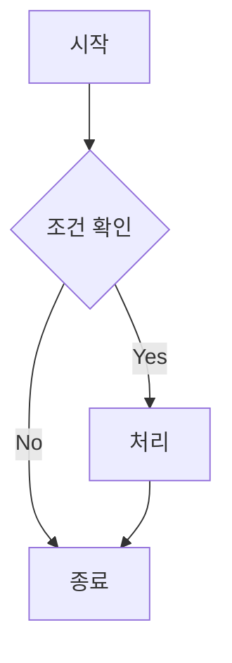

## Mermaid — 시퀀스 다이어그램

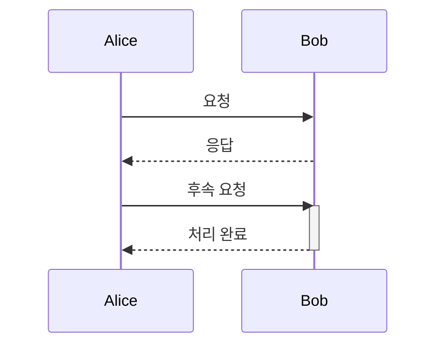

## Mermaid — 클래스 다이어그램

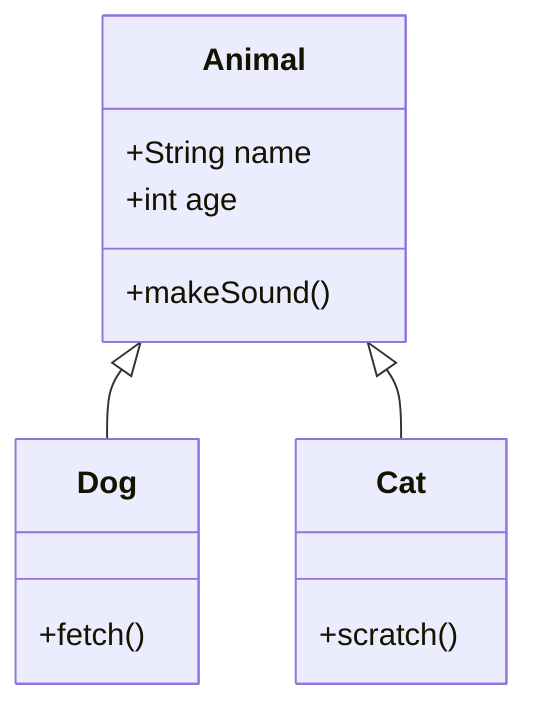

## Mermaid — 상태 다이어그램

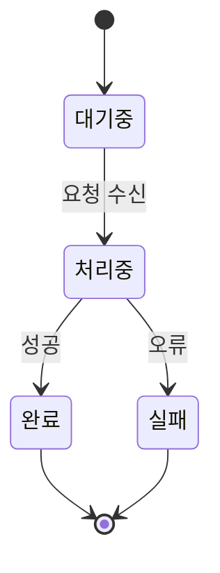

## Mermaid — ER 다이어그램

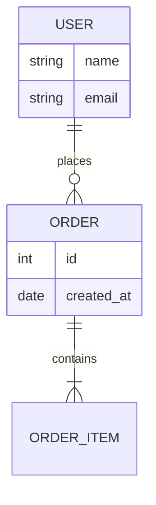

## Mermaid — 파이 차트

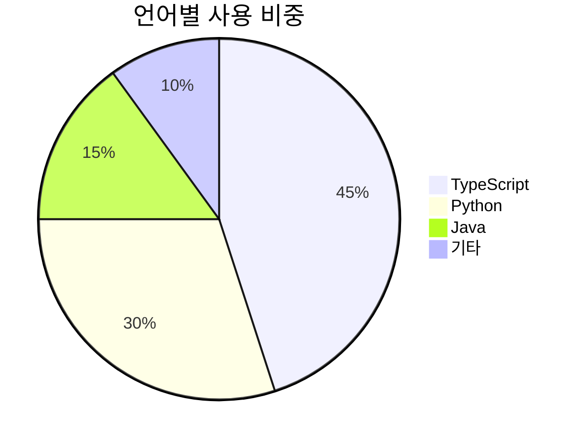

## Mermaid — 마인드맵

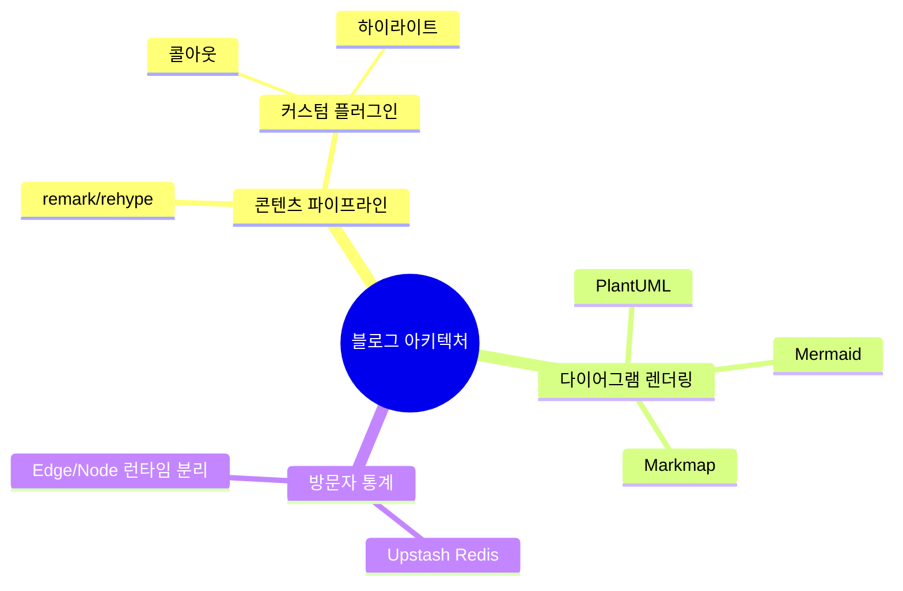

---

## PlantUML — 시퀀스 다이어그램

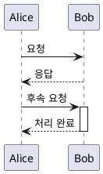

## PlantUML — 클래스 다이어그램

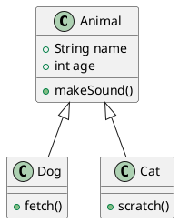

## PlantUML — 유스케이스 다이어그램

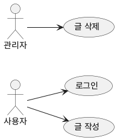

## PlantUML — 액티비티 다이어그램

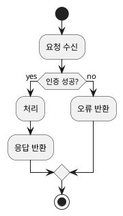

## PlantUML — 상태 다이어그램

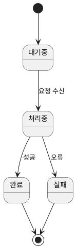

## PlantUML — 컴포넌트 다이어그램

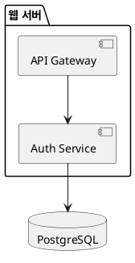

## PlantUML — 렌더링 실패 다이어그램 (페이지가 죽으면 안 됨)

```plantuml
@startuml
qwerty totally not valid plantuml keyword blah blah
@enduml
```

---

## Markmap — 마인드맵

```markmap
# 블로그 아키텍처
## 콘텐츠 파이프라인
- remark/rehype
- 커스텀 플러그인
  - 콜아웃
  - 하이라이트
## 다이어그램 렌더링
- Mermaid
- PlantUML
- Markmap
## 방문자 통계
- Upstash Redis
- Edge/Node 런타임 분리
```

## Markmap — 마인드맵2

```markmap
# Root
## Sub1
## Sub2
```

## Markmap — 깊은 트리 (레이아웃 폭 초과 확인용)

```markmap
# 루트
## A
### A-1
#### A-1-1
##### A-1-1-1
###### A-1-1-1-1
## B
### B-1
### B-2
### B-3
### B-4
### B-5
```

## Markmap — 넓은 트리 (세로 높이 초과 확인용)

```markmap
# 루트
## 가지1
- 잎1
- 잎2
- 잎3
- 잎4
- 잎5
- 잎6
- 잎7
- 잎8
- 잎9
- 잎10
- 잎11
- 잎12
- 잎13
- 잎14
- 잎15
```

---

## 언어 라벨 — 짧은 언어명

```bash
echo "hello"
```

## 언어 라벨 — 긴 언어명 (ellipsis 확인용)

```typescript
const x: number = 1
```

## 언어 라벨 — 매우 긴 가짜 언어명 (max-width 초과 확인용)

```verylonglanguagenamefortestingellipsis
just testing overflow
```

## title= 메타 — 짧은 파일명 (가운데 정렬 확인용)

```js title="app.js"
console.log("hello")
```

## title= 메타 — 긴 파일명 (가운데 정렬 + ellipsis 동시 확인용)

```js title="a-very-long-configuration-filename-example.config.js"
console.log("hello")
```

## title= + Mermaid — 라벨과 title 동시 표시 확인용

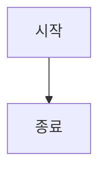
