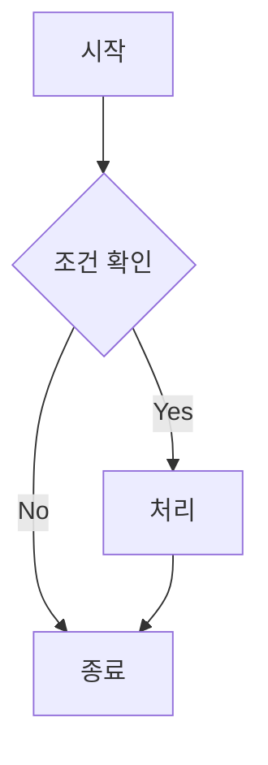

# Quickstart: Mermaid 다이어그램 렌더링 검증

이 기능이 실제로 동작하는지 로컬에서 확인하는 절차. constitution.md Principle I(빌드 +
`playwright-cli`로 실제 브라우저 구동해 검증, 필요 시 스크린샷은 `playwright` MCP)을 따른다.

## Prerequisites

- `package.json`에 `mermaid`, `svg-pan-zoom`이 설치되어 있어야 한다.
- `components/article/mermaid-diagram-handler.tsx`가 `app/article/[slug]/page.tsx`에서
  `CodeCopyHandler`/`ImageLightboxHandler`와 나란히 마운트되어 있어야 한다.

## 1. 유효한 다이어그램 + 문법 오류 다이어그램을 포함한 검증용 아티클 작성

```bash
mkdir -p content/articles
cat > content/articles/_mermaid-preview.md <<'EOF'
---
title: "Mermaid Preview (내부 검증용)"
category: "TEST"
publishedAt: "2026-08-15"
tags: ["TEST"]
showOnHomepage: false
---

## 정상 다이어그램



## 문법 오류가 있는 다이어그램 (페이지가 죽으면 안 됨)

```mermaid
flowchart TD
    A[시작 -->> B
```
EOF

npm run build
```

**Expected**: 빌드 성공(Mermaid는 클라이언트 런타임 렌더링이라 이 시점엔 문법을 검사하지 않음 —
빌드 실패 여부보다 아래 3단계의 런타임 폴백 확인이 핵심).

**⚠️ `content/articles/**` 변경이므로, 검증을 `npm run dev`로 이어간다면 이미 떠 있는 프로세스를
반드시 재시작해야 한다(AGENTS.md).**

## 2. 정상 다이어그램 렌더링 + 다크/라이트 시각 확인 (User Story 1)

```bash
npm run dev   # http://localhost:3999
```

`playwright-cli`로:
1. `/article/_mermaid-preview`로 이동
2. 라이트 테마에서 "정상 다이어그램" 섹션에 순서도 그림(SVG)이 보이는지 확인 — 원본 코드 텍스트가
   그대로 노출되면 안 됨
3. 테마 토글로 다크 전환 후 다시 확인 — 다이어그램이 다크 배경에서도 읽기 충분한 대비로 다시
   그려지는지(재렌더링되는지) 확인
4. 브라우저 콘솔에 하이드레이션/렌더링 에러가 없는지 확인

## 3. 문법 오류 다이어그램의 폴백 확인 (Edge Case, FR-009)

1. "문법 오류가 있는 다이어그램" 섹션에서 SVG 대신 원본 Mermaid 코드가 문법 강조된 코드
   블록으로 그대로 보이는지 확인
2. 이 섹션에 확대 버튼이 노출되지 않는지 확인(data-model.md — error 상태는 확대 대상 아님)
3. 페이지의 다른 섹션(정상 다이어그램, 이후 콘텐츠)이 이 오류로 영향받지 않고 정상 렌더링되는지
   확인

## 4. 복사 버튼 확인 (User Story 3, FR-004)

1. "정상 다이어그램" 섹션의 복사 버튼을 클릭
2. 클립보드 내용이 렌더링된 그림이 아니라 원본 Mermaid 코드 텍스트(```mermaid 안의 `flowchart TD...`)와
   정확히 일치하는지 확인

## 5. 확대 보기 창 확인 (User Story 2, FR-005~008)

1. "정상 다이어그램"의 확대 버튼 클릭 → 모달이 뜨는지, 배경 스크림/애니메이션이 기존 이미지
   라이트박스와 시각적으로 비슷한 느낌인지 확인
2. 상/하/좌/우 화살표 버튼 각각 클릭 → 다이어그램이 해당 방향으로 이동하는지 확인
3. 돋보기 + / − 버튼 클릭 → 다이어그램이 확대/축소되는지 확인
4. 2~3단계로 이동/배율을 흐트러뜨린 뒤 리셋(새로고침) 버튼 클릭 → 최초 위치/배율로 정확히
   돌아오는지 확인
5. ESC 또는 배경 클릭으로 모달이 닫히는지 확인

## 6. 회귀 확인 (SC-006)

- 기존에 발행된 아티클(`_mermaid-preview.md` 제외) 상세 페이지를 몇 개 열어, Mermaid 관련 UI가
  새로 생기지 않았는지(신규 코드 경로가 no-op인지) 확인
- 홈 페이지(`/`)에 `_mermaid-preview`가 노출되지 않는지 확인(`showOnHomepage: false`)

## 7. 정리

```bash
rm content/articles/_mermaid-preview.md
```

검증용 아티클은 발행 콘텐츠가 아니므로, 시각 확인이 끝나면 삭제한다. 삭제 후에도
`npm run dev`/`next start` 프로세스를 재시작해야 목록에서 실제로 사라진 상태를 확인할 수 있다
(AGENTS.md `content/articles/**` 캐싱 주의사항).
