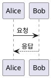

# Quickstart: PlantUML 다이어그램 렌더링 검증

이 기능이 실제로 동작하는지 로컬에서 확인하는 절차. constitution.md Principle I(빌드 +
`playwright-cli`로 실제 브라우저 구동해 검증, 필요 시 스크린샷은 `playwright` MCP)을 따른다.

## Prerequisites

- `package.json`에 `plantuml-encoder`, `@types/plantuml-encoder`가 설치되어 있어야 한다.
- `lib/content/plugins/rehype-plantuml.ts`가 `lib/content/pipeline.ts`에 연결되어 있어야 한다.
- `components/article/plantuml-diagram-handler.tsx`가 `app/article/[slug]/page.tsx`에서
  `CodeCopyHandler`/`ImageLightboxHandler`/`MermaidDiagramHandler`와 나란히 마운트되어 있어야 한다.
- **서버는 반드시 일반 `npm run dev`(로컬/인메모리 Redis 모드)로 띄운다.** `npm run dev:docker`는
  쓰지 않는다 — Docker 모드는 실제 방문자 통계 위젯 검증용이라 이 기능과 무관하고, 인메모리
  모드로 띄워야 방문자 통계 위젯이 항상 `0`에서 시작해(AGENTS.md "In-memory fallback for local
  dev") 다이어그램 검증 화면에 실제 운영 데이터가 섞여 보이지 않는다.

## 0. 구현 착수 전 — 검증용 아티클을 먼저 작성

실제 컴포넌트/플러그인을 만들기 전에, 검증 대상이 될 마크다운부터 만들어둔다(빌드 타임 플러그인이
`lang === "plantuml"`을 정확히 찾아내는지 처음부터 실제 콘텐츠로 확인하기 위함).

```bash
mkdir -p content/articles
cat > content/articles/_plantuml-preview.md <<'EOF'
---
title: "PlantUML Preview (내부 검증용)"
category: "TEST"
publishedAt: "2026-08-15"
tags: ["TEST"]
showOnHomepage: false
---

## 정상 다이어그램



## 렌더링 실패 다이어그램 (페이지가 죽으면 안 됨)

```plantuml
@startuml
qwerty totally not valid plantuml keyword blah blah
@enduml
```
EOF
```

두 번째 블록은 research.md에서 실측으로 확인한, PlantUML 서버가 "Welcome to PlantUML!"
플레이스홀더를 반환하는(= `data-diagram-type` 속성이 없는) 케이스를 그대로 재현한 것이다 —
HTTP 200을 반환하지만 우리 판정 기준(contracts #3)으로는 실패로 처리되어야 한다.

**⚠️ `content/articles/**` 변경이므로, 이 파일을 만들거나 고칠 때마다 이미 떠 있는
`npm run dev` 프로세스를 반드시 재시작해야 한다(AGENTS.md).**

## 1. 빌드 통과 확인

```bash
npm run build
```

**Expected**: `rehype-plantuml.ts`는 네트워크 호출이 전혀 없는 순수 문자열 변환이므로(contracts
#1), 이 시점에 실패할 이유가 없다. 실패하면 플러그인 구현이 계약을 위반한 것이다.

## 2. 정상 다이어그램 렌더링 확인 (User Story 1)

```bash
npm run dev   # http://localhost:3999, 반드시 일반 모드(Prerequisites 참고)
```

`playwright-cli`로(부족하면 `playwright` MCP 스크린샷으로 보강):

1. `/article/_plantuml-preview`로 이동
2. 상단 방문자 통계 위젯이 `0`에서 시작하는지 확인(로컬 모드 확인 겸)
3. 라이트 테마에서 "정상 다이어그램" 섹션에 시퀀스 다이어그램 그림(SVG)이 보이는지 확인 — 원본
   코드 텍스트가 그대로 노출되면 안 됨
4. 테마 토글로 다크 전환 후, 다이어그램을 감싼 라이트 카드 배경으로 여전히 읽기 충분한 대비를
   유지하는지 확인(research.md — 다이어그램 자체는 재렌더링되지 않음)
5. 브라우저 콘솔에 네트워크/렌더링 에러가 없는지 확인

## 3. 렌더링 실패 다이어그램의 폴백 확인 (Edge Case, FR-008/FR-009)

1. "렌더링 실패 다이어그램" 섹션에서 SVG 대신 원본 PlantUML 코드가 그대로 보이는지 확인
2. 이 섹션에 확대 버튼이 노출되지 않는지 확인(data-model.md — error 상태는 확대 대상 아님)
3. 페이지의 다른 섹션(정상 다이어그램, 이후 콘텐츠)이 이 실패로 영향받지 않고 정상 렌더링되는지
   확인

## 4. 복사 버튼 확인 (User Story 3, FR-004)

1. "정상 다이어그램" 섹션의 복사 버튼을 클릭
2. 클립보드 내용이 렌더링된 그림이 아니라 원본 PlantUML 코드 텍스트(`@startuml ... @enduml`)와
   정확히 일치하는지 확인

## 5. 확대 보기 창 확인 (User Story 2, FR-005~007)

1. "정상 다이어그램"의 확대 버튼 클릭 → Mermaid와 동일한 모달이 뜨는지 확인
2. 상/하/좌/우 이동, 돋보기 +/-, 리셋, ESC/배경 클릭 닫기까지 012의 확인 항목을 동일하게 반복
3. 같은 페이지에 Mermaid 다이어그램이 있다면(별도 검증용 아티클과 비교) 두 종류의 확대/복사
   버튼 위치·스타일·인터랙션이 구분 불가능한지 육안으로 비교(SC-004)

## 6. 회귀 확인 (SC-007)

- 기존에 발행된 아티클(`_plantuml-preview.md` 제외) 상세 페이지를 몇 개 열어, PlantUML 관련 UI가
  새로 생기지 않았는지 확인
- 홈 페이지(`/`)에 `_plantuml-preview`가 노출되지 않는지 확인(`showOnHomepage: false`)

## 7. 문제 발견 시

각 단계에서 이상 동작을 발견하면 즉시 원인을 고치고 해당 단계(및 그 이전에 영향을 줄 수 있는
단계)를 다시 실행해 통과를 확인한다 — 통과하지 못한 상태로 다음 Phase로 넘어가지 않는다.

## 8. 정리

```bash
rm content/articles/_plantuml-preview.md
```

검증용 아티클은 발행 콘텐츠가 아니므로, 시각 확인이 끝나면 삭제한다. 삭제 후에도
`npm run dev`/`next start` 프로세스를 재시작해야 목록에서 실제로 사라진 상태를 확인할 수 있다
(AGENTS.md `content/articles/**` 캐싱 주의사항).
